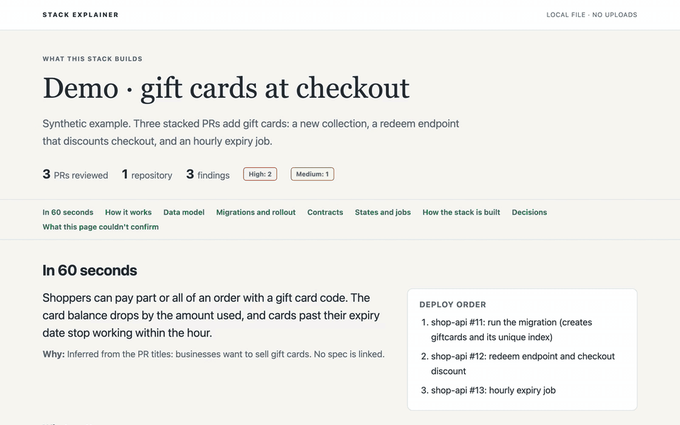
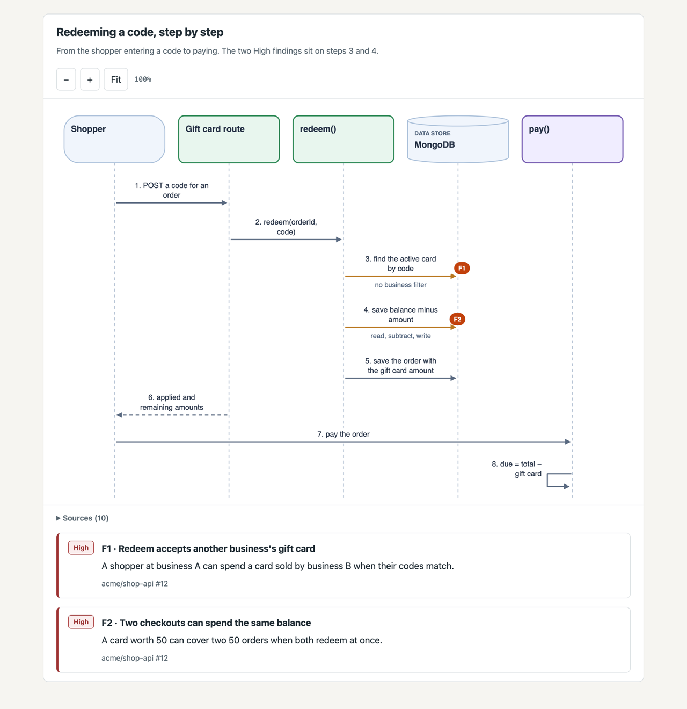

# mstack

The agent skills I use every day to ship work as stacked pull requests, cleaned
up so anyone can use them. They work in Claude Code and Codex. Some use
[T3 Code](https://github.com/pingdotgg/t3code) features when they are available
and fall back to native tools when they are not.



## Skills

| Skill | Say | What it does |
|---|---|---|
| `starting-features` | "start this feature" | Reads the existing flow before designing, names the code it will extend, and splits the work into reviewable PRs. |
| `submit` | "submit the stack" | Publishes a `gh stack`, writes PR descriptions that lead with the problem, attaches screenshots, and returns checked links. Watches and merges when asked. |
| `review-stack` | "review this stack" | Reviews one PR or a whole stack with four parallel reviewers (correctness, security, data, reuse), checks every finding independently, and renders a local page explaining what the stack builds. |
| `pr-comments-walkthrough` | "go through the comments" | Takes you through reviewer comments one at a time with a checked recommendation, then applies your decisions in the PRs that own the code. |
| `merge-conflicts` | (automatic) | Resolves rebase and restack conflicts from each side's intent, including after a squash merge. |
| `verify-ui` | "verify the UI" | Checks a frontend change in a real browser: the flow, the way back, the states that changed and both viewports. |

In order of use: `starting-features` plans the slices, `verify-ui` proves the UI,
`submit` publishes the stack, `review-stack` reviews it, `pr-comments-walkthrough`
handles the review, and `merge-conflicts` steps in when a restack stops.

Some skills call others. Install the ones they need too:

- `review-stack` uses `verify-ui`.
- `submit` uses `merge-conflicts` and `verify-ui`.
- `pr-comments-walkthrough` uses `submit`.
- `starting-features` uses `submit`, `verify-ui` and `review-stack`.

## What a review looks like

`review-stack` gives its verdicts and findings in chat. For a stack it also writes
a local page explaining what the stack builds: the story, the architecture, the
data model, the rollout order and the decisions. Each drawn claim cites the line
it came from, and each finding is marked on the diagram step where it happens.



Both images come from a made-up gift-card stack; the commands under
[Make them yours](#make-them-yours) build the same page on your machine.

## Install

```bash
git clone https://github.com/xmansyx/mstack
cp -R mstack/skills/* ~/.claude/skills/   # Claude Code
cp -R mstack/skills/* ~/.codex/skills/    # Codex
```

## Requirements

- An authenticated [GitHub CLI](https://cli.github.com) (`gh`). Attaching
  screenshots to PRs needs 2.99.0 or later.
- The [gh-stack](https://github.com/github/gh-stack) extension for `submit` and
  `merge-conflicts`: `gh extension install github/gh-stack`.
- `python3` (3.9 or later, standard library only) for `review-stack`'s resolver
  and page renderer.
- Subagents for `review-stack`. Each verifier runs on a different provider's
  model than the reviewer it checks when one is available, so the two don't share
  blind spots; T3 Code reaches other providers with `delegate_task`. Elsewhere,
  each verifier still gets a fresh context.

## Make them yours

These are starting points. Edit them.

- `review-stack` reviews against your repository's own `AGENTS.md`, `CLAUDE.md`
  or `CONTRIBUTING.md`. Copy
  [`conventions.example.md`](skills/review-stack/conventions.example.md) into your
  repository, replace its rows with rules your code actually follows, and link it
  from `AGENTS.md`.
- [`AGENTS.example.md`](AGENTS.example.md) holds the personal rules these skills
  were written alongside: read-only by default for questions and reviews, evidence
  for every completion claim, delete old code by default. Put the ones you want in
  your `CLAUDE.md` or `AGENTS.md`, so you can update the skills without losing them.

`review-stack` has its own tests:

```bash
python3 -m unittest discover -s skills/review-stack/tests
python3 skills/review-stack/tests/make_demo.py /tmp/mstack-demo
python3 skills/review-stack/scripts/render_review.py /tmp/mstack-demo/input.json
```

The last command prints the path of a demo review page built from a made-up
gift-card stack.

## Credits

`submit`'s [watching guide](skills/submit/watching.md) is adapted from
[tstack](https://github.com/t3dotgg/tstack)'s `babysit-pr` and `full-send`
(MIT, © 2026 Theo Browne), and this README follows tstack's layout.

## License

[MIT](LICENSE)
